# Petal Path

A calm coaching app for women who want one simple place to act on their health and fitness goals: a 24-week programme that opens week by week, daily habits that grow a six-petal flower, activity logging, block check-ins, and a coach view to look after every client. Built with Flutter and Riverpod. All data is sample data.

## Demo

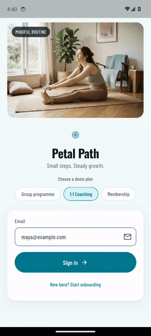

Captured on an Android emulator. The same codebase builds for iOS.

## Screenshots

| Sign in | Home | Learn | Lesson |
|---|---|---|---|
| 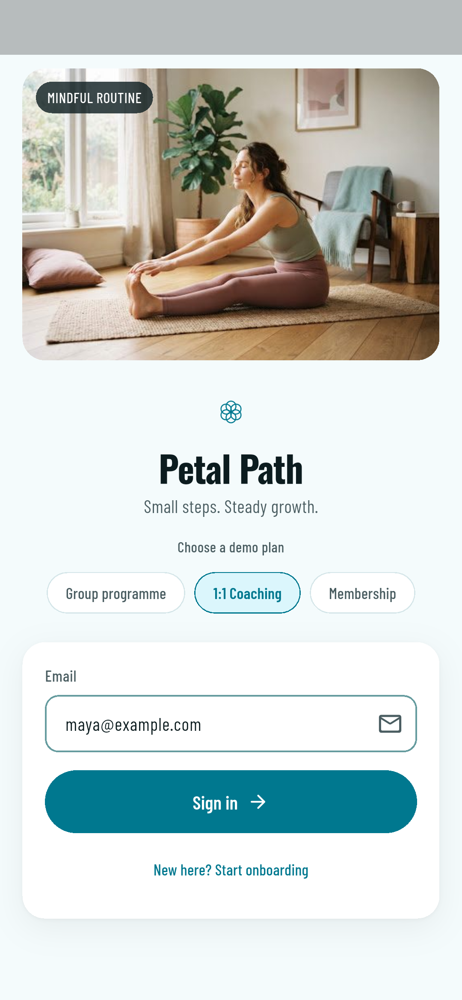 | 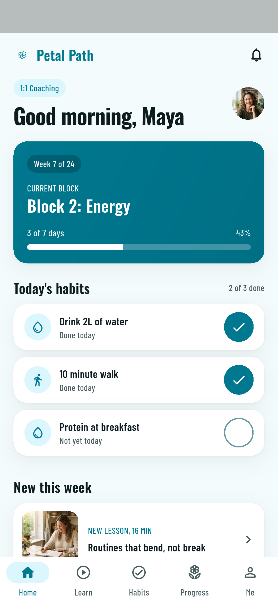 | 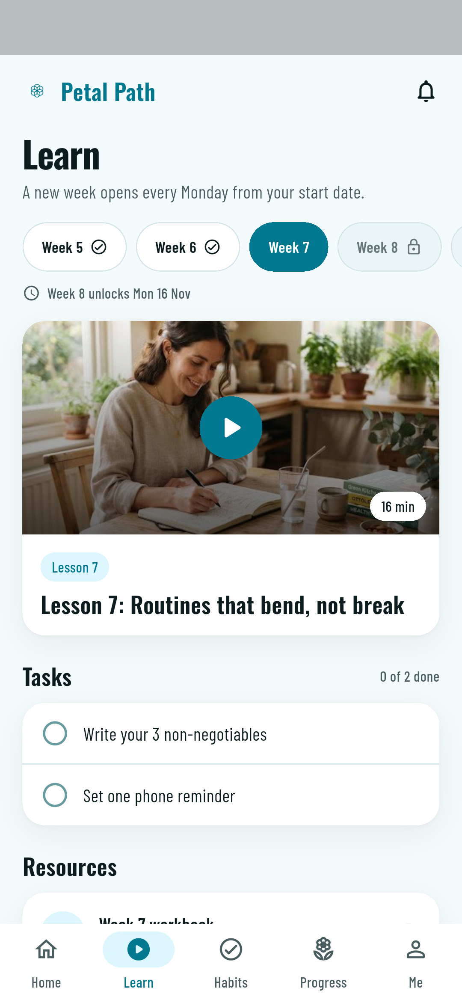 | 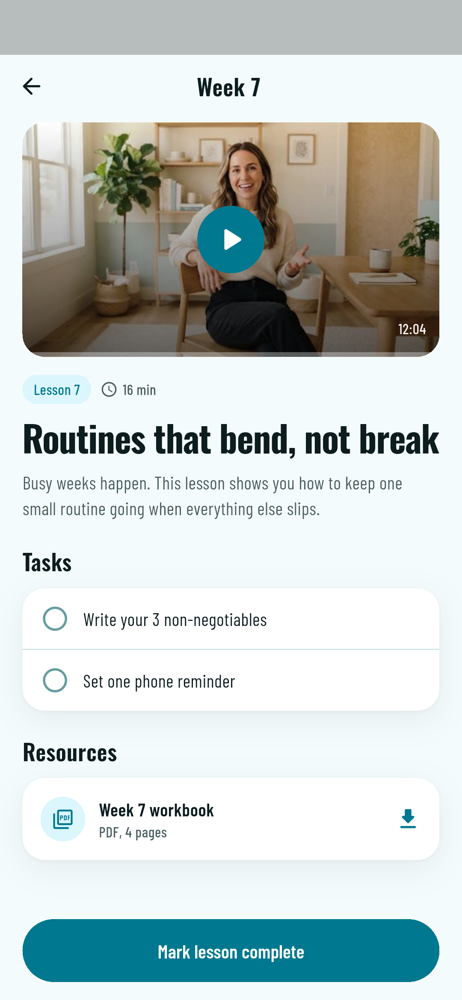 |

| Habits | Flower | Activity | Check-in |
|---|---|---|---|
| 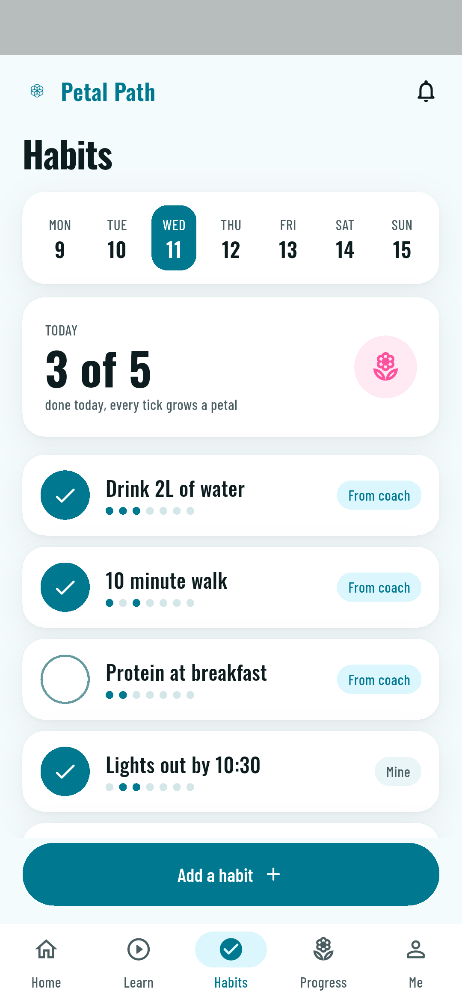 | 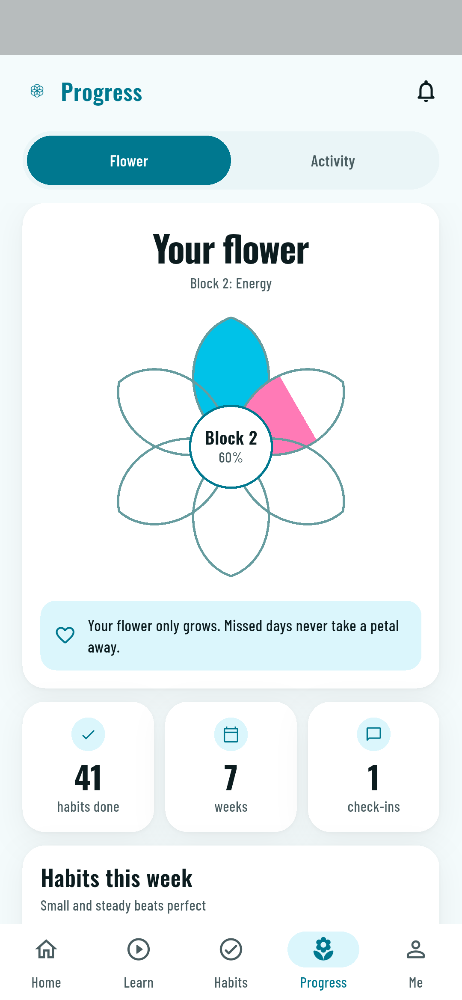 | 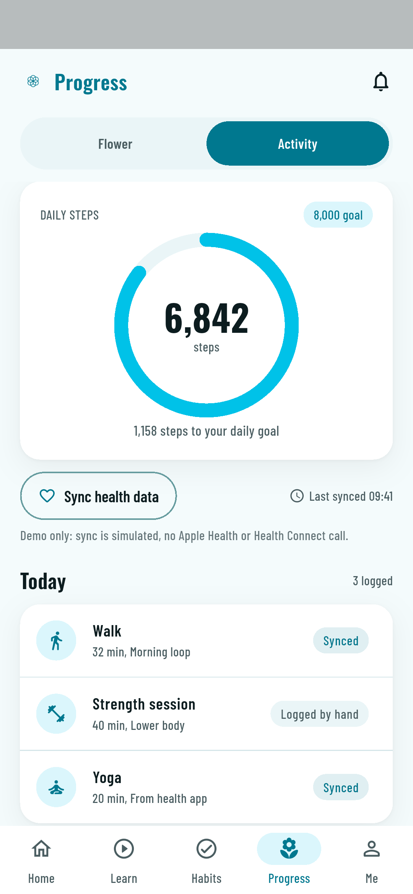 | 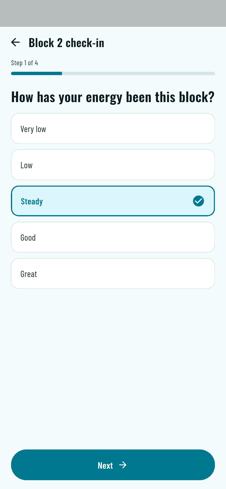 |

| Me | Coach view | First login |
|---|---|---|
| 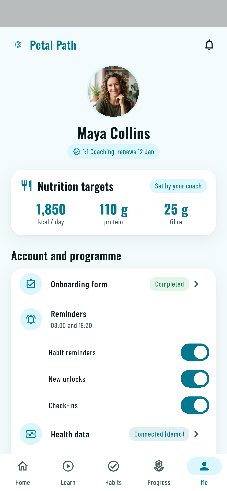 | 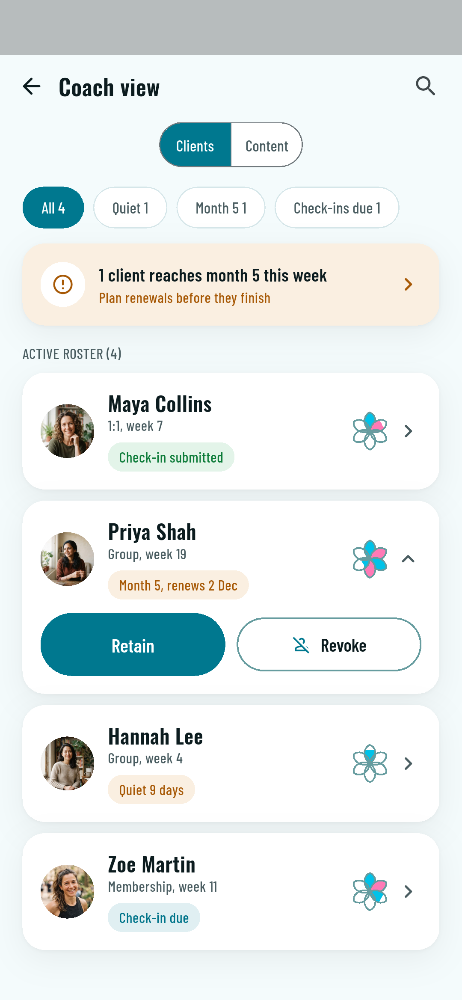 | 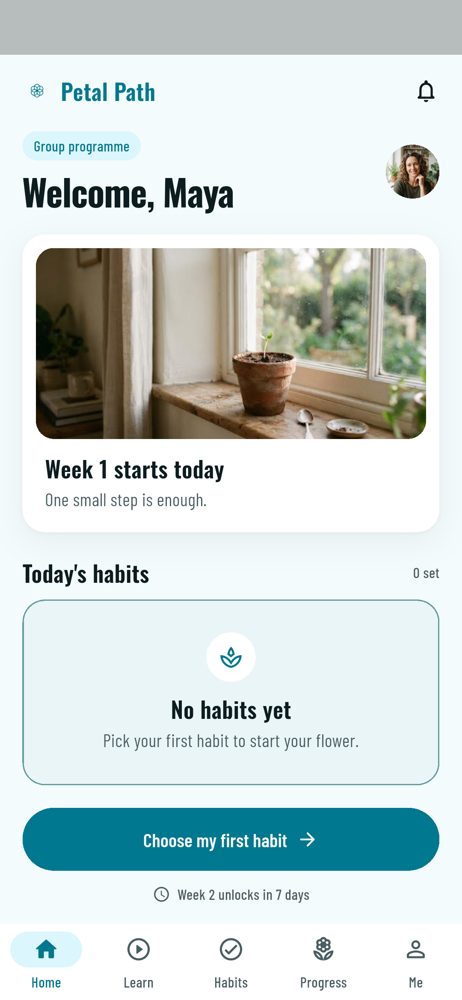 |

## What it shows

- **Three plans, one app.** Pick a demo plan on the sign-in screen. Group programme opens one week at a time, 1:1 coaching adds a personal plan (nutrition targets, workout logging, onboarding form), and membership opens all 24 weeks from day 1.
- **Date-based unlocks.** 24 weeks in six 4-week blocks, counted from the first login. Locked weeks show the date they open.
- **Home dashboard.** This week and block, today's habits, the new lesson and the open check-in, with one main action.
- **Learn.** Weekly lesson video (simulated player), tasks to tick, and PDF resources.
- **Habits.** Coach habits plus your own, a 7-day streak per habit, and a habit library to add from.
- **Progress flower.** Six petals, one per block. Every habit you tick fills the current petal, and unticking never takes a petal away.
- **Activity.** Log activity by hand or tap "Sync health data". The sync is simulated: no Apple Health or Health Connect call is made. Body and food cards sit under it.
- **Check-ins.** A four-step block check-in and a 1:1 onboarding form, one question per screen.
- **Reminders.** Toggles for habit, unlock and check-in reminders, and an in-app preview of the notifications.
- **Coach view.** Every client with progress, check-in status, renewals, quiet-client and month-5 flags, retain or revoke access, and editable notification wording.

## How it works

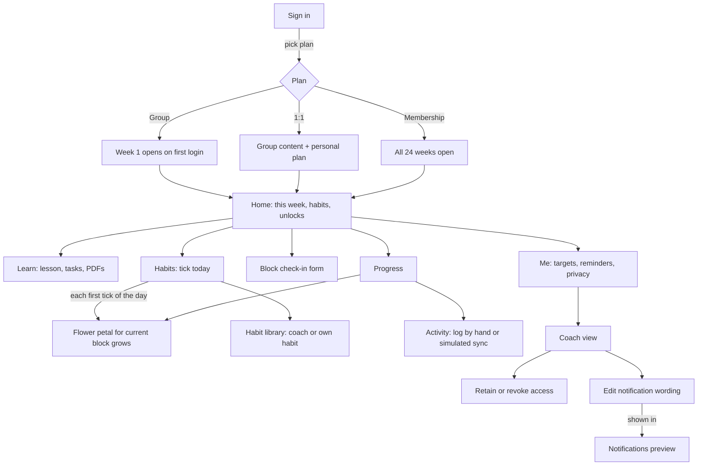

## Architecture

```
lib/
  main.dart, app.dart        ProviderScope, MaterialApp, five-tab shell
  models/                    plain data classes: tiers, lessons, habits, activity, clients
  data/mock_data.dart        sample content, demo accounts, fixed demo date
  state/providers.dart       Riverpod Notifiers: session, programme unlocks, habits,
                             flower, lessons, activity + simulated sync, check-ins,
                             reminders, notification copy, coach roster
  screens/                   one file per screen
  theme/, widgets/           design tokens, shared components, the petal flower painter
design/                      source screens, tokens and logo the app was built to match
test/                        unit tests for the unlock rules, widget tests per screen
integration_test/            on-device screenshot run and demo walkthrough
```

- **State.** Each feature is a Riverpod `Notifier`. Signing in loads the demo account for the chosen plan and resets the other providers, so switching plans is instant.
- **Unlocks.** `programmeFor()` turns the first-login date and the plan into the current week, block, last unlocked week and next unlock date. A fixed demo date keeps screenshots and tests repeatable.
- **Flower.** Ticking a habit credits the current block's petal once per habit per day. The credit is never removed, which is how the flower "never goes backwards".
- **Health sync.** `ActivityNotifier.syncHealth()` waits briefly and adds a fixed payload. A real build would replace it with HealthKit / Health Connect behind the same method.
- **Design.** Colors, type scale (Oswald titles, Barlow Condensed body), radii and spacing come from the tokens in `design/DESIGN.md`. The fonts are bundled, so the app works offline.

## Run

```sh
flutter pub get
flutter run
flutter test
```

Tested with Flutter 3.35.0 (newer Flutter needs the Android Gradle wrapper raised to 8.14+). Tap a plan on the sign-in screen, then Sign in. Open the coach view from Me.
